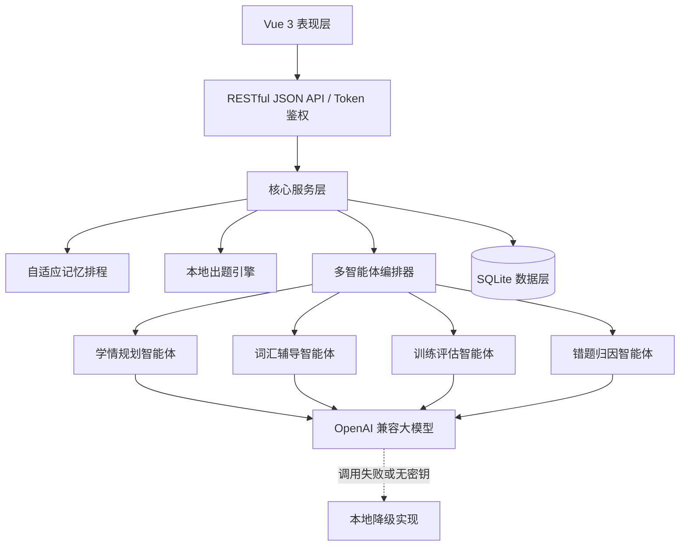

# 智枢词训

**基于多智能体协同的四级英语自适应词汇学习项目**

智枢词训面向大学英语四级（CET-4）备考学生，将记忆科学规律、多智能体协同与自适应调度技术结合，提供从词汇画像、个性化复习安排到薄弱环节诊断与专项特训的完整学习闭环。

## 项目简介

多数通用背词工具采用统一复习节奏，学习计划与个人掌握情况脱节，高频词、薄弱题型和顽固词汇也难以形成有效的补救闭环。智枢词训以考频及听、说、读、写、译相关考查分布构建词汇画像，通过考频与难度加权的记忆排程算法动态安排复习，并由学情规划、词汇辅导、训练评估、错题归因四类智能体协同完成“规划—学习—评估—归因—特训”的学习过程。

系统前端基于 Vue 3、Vite 6 和 Vue Router 4，后端基于 Django 6 和 SQLite，通过 RESTful JSON API 与 Bearer Token 完成前后端交互。大语言模型经 OpenAI 兼容协议接入，未配置密钥或调用失败时自动切换到本地实现，核心功能不依赖外部网络即可运行。

## 项目背景

大学英语四级词汇学习存在四个常见问题：

1. **计划千人一面**：统一节奏无法反映个人掌握差异，高频词和薄弱题型难以优先强化。
2. **复习间隔僵化**：固定间隔未结合四级考频、词汇难度和个人记忆状态。
3. **薄弱点不可见**：拼写、词义、形近词和听力辨音等薄弱维度缺少定位与可视化。
4. **错题缺少后续干预**：答错后缺少归因、补救和专项特训，导致反复出错。

智枢词训以学习者真实作答数据为依据，将词汇画像、记忆状态和题型表现统一到可解释的学习闭环中。

## 核心创新

- **考频与四技能词汇画像**：在单词、音标和释义之外，记录阅读、听力、翻译、写作相关词频与难度信息。
- **考频与难度加权排程**：以艾宾浩斯间隔重复为基础，通过阶段 `stage`、熟练度 `ease`、遗忘次数 `lapses` 和考频、难度因子动态计算下次复习时间。
- **四类智能体协同**：学情规划、词汇辅导、训练评估和错题归因共享学习记录与记忆状态，服务过程可解释、可追踪。
- **本地出题与分级降级**：训练评估由本地出题引擎完成；大模型不可用时，规划、辅导、评估和归因自动切换本地实现。

## 系统架构



## 核心功能

| 编号 | 模块 | 功能说明 |
| --- | --- | --- |
| F1 | 背诵 | 单词卡展示发音、考频与释义，支持认识、模糊、忘记三级反馈 |
| F2 | 练习 | 支持英译汉、汉译英、拼写、诵读四种题型并自动判分 |
| F3 | 计划 | 生成今日队列（新学、复习、顽固词）及未来 7 天复习安排 |
| F4 | 多智能体 | 提供学情规划、词汇辅导、训练评估、错题归因四类服务 |
| F5 | 统计 | 展示掌握数量、正确率、连续天数与题型正确率 |
| F6 | 词本 | 自动归集错题与顽固词，并提供专项特训入口 |
| F7 | 词典 | 支持词库浏览、检索与词条详情查看 |

## 多智能体职责

| 智能体 | 输入 | 主要工作 | 输出 |
| --- | --- | --- | --- |
| 学情规划 | 统计、错题、记忆状态 | 生成自适应日计划 | 新学、复习、特训配比及理由 |
| 词汇辅导 | 词条、记忆状态 | 生成个性化讲解 | 释义、词根词缀、例句、易混辨析 |
| 训练评估 | 作答数据 | 组卷判分并更新记忆状态 | 成绩报告、薄弱题型、顽固词 |
| 错题归因 | 错题与顽固词数据 | 按错误维度归类并生成建议 | 错因地图、特训入口 |

## 技术栈

| 层级 | 技术 |
| --- | --- |
| 前端 | Vue 3.5、Vite 6、Vue Router 4 |
| 后端 | Django 6.1、SQLite、SimpleUI |
| 接口 | RESTful JSON API、Bearer Token 鉴权 |
| AI | OpenAI 兼容大模型（DeepSeek 等）、本地降级 |
| 部署 | 前端构建后由 Django 同源托管 |

## 项目结构

```text
.
├─ core/                   # 词汇、记录、排程、统计、智能体与 API
│  ├─ data/word_bank.json  # 内置 CET-4 示例词库
│  ├─ ebbinghaus.py        # 考频与难度加权排程算法
│  ├─ services.py          # 学习计划、统计、词本与智能体服务
│  └─ views.py             # JSON API
├─ ct4project/             # Django 项目配置与前端托管
├─ frontend/
│  ├─ src/                 # Vue 3 源代码
│  └─ dist/                # 已构建前端产物
├─ docs/                   # 项目计划书与答辩演示
├─ manage.py
├─ requirements.txt
├─ .env.example
├─ 一键启动.bat
└─ build.sh
```

## GitHub Pages 一键部署网页

仓库已经内置 GitHub Actions 工作流 `.github/workflows/deploy-pages.yml`。把项目上传到 `main` 分支后，GitHub 会自动完成前端构建并发布静态演示网页，不需要自行购买服务器。

部署完成后访问：

`https://3551584152-alt.github.io/douxuancdui-zhishucixun/`

GitHub Pages 版本使用浏览器本地数据运行，包含背诵、练习、计划、统计、词典、错题本和四类智能体演示。完整 Django 后端仍可在本地或云服务器运行，两条部署路径共用同一套 Vue 源码。

### 首次发布

1. 将项目推送到 GitHub 仓库的 `main` 分支。
2. 打开仓库的 `Actions` 页面，等待 `Deploy GitHub Pages` 工作流完成。
3. 打开下方网址即可访问网页。

如果仓库设置中尚未启用 Pages，工作流会自动启用。若组织策略禁止自动启用，请在 `Settings → Pages → Build and deployment` 中将 Source 设置为 `GitHub Actions`。
## 快速开始

### Windows 一键启动

1. 安装 Python 3.12 或更高版本。
2. 双击 `一键启动.bat`。
3. 脚本会自动创建虚拟环境、安装后端依赖、初始化数据库并启动服务。
4. 浏览器访问 `http://127.0.0.1:8002/`。
5. 首次使用可在登录页注册账号。

仓库已经包含构建后的前端资源，因此不安装 Node.js 也可以直接运行。需要重新构建前端时再安装 Node.js 20 或更高版本。

### 手动启动

```bash
# 后端依赖
python -m venv .venv
# Windows
.venv\Scripts\activate
# Linux / macOS
source .venv/bin/activate

pip install -r requirements.txt
python manage.py migrate
python manage.py seed_words

# 前端构建
cd frontend
npm ci
npm run build
cd ..

# 启动
python manage.py runserver 127.0.0.1:8002
```

访问 `http://127.0.0.1:8002/`。

## 大模型配置

大模型能力为可选配置。复制 `.env.example` 为 `.env` 并填写：

```env
LLM_API_KEY=
LLM_BASE_URL=https://api.deepseek.com/v1
LLM_MODEL=deepseek-chat
```

如果未配置密钥、网络不可用或模型返回异常，系统会自动切换到本地规划器、本地词条库、本地出题引擎和本地规则归因。API Key 仅保存在服务端 `.env` 文件中，不会进入前端代码。

## API 概览

| 模块 | 接口 |
| --- | --- |
| 健康检查 | `GET /api/health` |
| 登录注册 | `POST /api/auth/login`、`POST /api/auth/register` |
| 今日词汇 | `GET /api/words/today` |
| 词库与词典 | `GET /api/words`、`GET /api/words/lookup` |
| 学习记录 | `POST /api/records`、`POST /api/records/sync` |
| 学习计划 | `GET /api/plan/daily` |
| 统计 | `GET /api/stats/summary` |
| 错题与顽固词 | `GET /api/notebook/wrong`、`GET /api/notebook/stubborn` |
| AI 与智能体 | `POST /api/ai/example`、`POST /api/agents/*` |

## 测试情况

项目在本地运行环境完成了主要功能测试，以下用例均已通过：

| 编号 | 测试项 | 结果 |
| --- | --- | --- |
| T1 | 注册与登录 | 通过 |
| T2 | 背诵与三级反馈 | 通过 |
| T3 | 四题型练习与判分 | 通过 |
| T4 | 今日队列与 7 天计划 | 通过 |
| T5 | 学情规划智能体 | 通过 |
| T6 | 统计汇总 | 通过 |
| T7 | 错题与顽固词本 | 通过 |
| T8 | 词典检索 | 通过 |
| T9 | 无大模型配置下的降级运行 | 通过 |

## 项目文档

- [项目计划书](docs/都选c队_智枢词训_项目计划书.docx)
- [答辩演示](docs/都选c队_智枢词训_答辩演示.pptx)

## 团队信息

- 学校：陕西科技大学镐京学院
- 学院：计算机学院
- 专业：计算机科学与技术
- 团队：都选 C 队
- 负责人：李帅
- 团队成员：李帅、张耀川、叶俊鹏、闫纪业
- 指导教师：朱赖红

## 安全说明

- 密码经过哈希存储，登录后使用 Bearer Token。
- 大模型密钥只保存在服务端环境变量中。
- 学习者数据遵循最小化收集原则，正式部署前应补充 HTTPS、权限审计和合规评估。